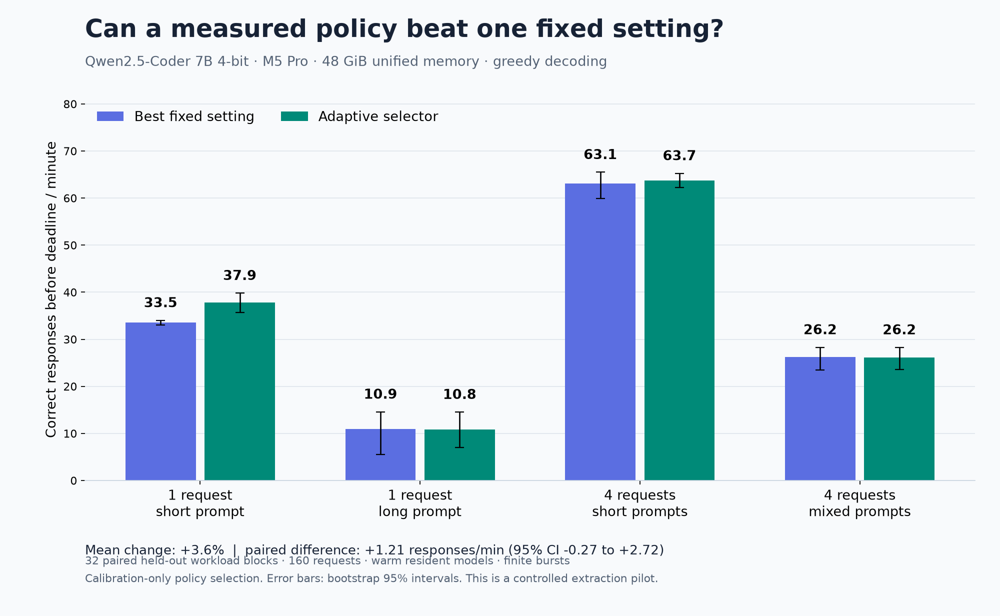

# Mac Inference Lab

A working local MLX configuration runner, measured policy selector and localhost JSON API.

The first version selects an execution configuration **between drained batches**, using queue size and prompt length. It supports plain serial generation, 4/8-bit KV caches, greedy speculation with a smaller model, and two plain batching configurations. It rejects unsupported combinations explicitly.

**Measured pilot:** +3.6% average goodput versus the calibration-selected fixed setting, with a 95% paired difference interval of −0.27 to +2.72 responses/minute. The interval includes zero; an overall improvement is not established. Both policies scored 77/80 on held-out tasks. [Read the results and limits](RESULTS.md).



## Install on another Apple silicon Mac

The measured environment uses Python 3.12 and the exact versions in `requirements-lock.txt`. MLX GPU execution requires a supported Apple silicon/macOS environment. Other machines can inspect results and run the pure Python audit.

```sh
git clone https://github.com/zeeshan8281/mac-inference-lab.git
cd mac-inference-lab
python3.12 -m venv .venv
.venv/bin/python -m pip install -r requirements-lock.txt
.venv/bin/python download_models.py --out models

./run.sh --target models/qwen-coder-7b --draft models/qwen-coder-1.5b \
  pilot --out runs/my-run --calibration-reps 3 --test-reps 8 --max-hours 4
./run.sh --target models/qwen-coder-7b --draft models/qwen-coder-1.5b \
  serve --policy runs/my-run/policy.json --port 8766
```

The download script uses pinned Hugging Face revisions in `models.json` and checks the files against their measured SHA-256 hashes. Allow about 5 GB for weights. Model weights are separate downloads governed by their model licenses; the project's MIT license covers this code. Installing the project with `pip install -e .` also provides a `mac-inference-lab` command.

Recalibrate on your own hardware. A saved policy describes the measured device and workload; matching software and weights alone does not establish identical performance.

## Quick start on this Mac

From this directory:

```sh
./run.sh pilot --out runs/my-run --calibration-reps 3 --test-reps 8 --max-hours 4
./run.sh serve --policy runs/pilot-002/policy.json --port 8766
```

The wrapper uses `.venv` when present, otherwise this workspace's existing `work/recovery-venv`, then `python3`. The default model paths point to this workspace's local weights. Set `INFERENCE_LAB_PYTHON` to another compatible Python interpreter if needed. Outside this workspace, specify model paths **before** the subcommand:

```sh
./run.sh --target /path/to/target --draft /path/to/draft pilot --out runs/another-run
```

The pilot ends when its prescribed runs finish. `--max-hours 4` is a ceiling, not a claim that every run lasts four hours. A nonempty output directory is never overwritten.

## Use the local API

```sh
curl http://127.0.0.1:8766/health

curl http://127.0.0.1:8766/generate \
  -H 'Content-Type: application/json' \
  -d '{"prompt":"Return only the JSON array [1,2,3].","max_tokens":64}'
```

Responses include generated text, the selected configuration, actual batch observations, prompt/output token counts, queue wait, completion time and peak active MLX memory. The API binds only to `127.0.0.1`. It is a non-streaming JSON API, not an OpenAI-compatible server.

The HTTP response is JSON; its `text` field is raw model output and can contain Markdown fences or model mistakes. No grammar-constrained output is implemented.

`memory_budget_gib` optionally lowers the calibrated soft admission budget. Uncalibrated prompt lengths, oversized queues and budgets without a feasible configuration are rejected. Requests are collected for up to 40 ms into groups of at most four. Each group completes before the next is selected.

To test the running API, including four concurrent real model requests:

```sh
.venv/bin/python smoke_server.py --out runs/api-smoke-new.json
```

## What is implemented

| Configuration | Actual path |
|---|---|
| `serial` | MLX-LM serial greedy generation, ordinary KV cache |
| `kv8`, `kv4` | Serial generation with actual quantized KV caches, quantization start threshold 0 |
| `draft2` | Serial greedy speculative generation, two draft tokens |
| `batch4_chunk256` | Up to four requests, unquantized KV, 256-token prefill chunks |
| `batch4_chunk1024` | Up to four requests, unquantized KV, 1024-token prefill chunks |

The installed BatchGenerator API has no KV-quantization or draft-model parameter. This implementation does not pretend that these flags compose.

The target and draft have identical actual token mappings but different padded output dimensions. Every configuration masks the unused padding rows. A real GPU gate checks greedy draft output against the serial baseline before calibration. Stochastic distribution equivalence is outside this version's scope.

## Measurement and policy training

1. Generate deterministic, disjoint calibration and held-out register-extraction fixtures. Three exact records must be returned in order; values, integer types, extra fields and duplicate keys are checked.
2. Warm every execution path. Confirm actual quantized-cache types and multiple generated responses per batch.
3. Set a per-workload deadline to 1.25 times a separate serial warmup's total burst duration. Freeze these deadlines before calibration.
4. Replay the same tasks across all configurations, randomizing configuration order within workload/replicate blocks.
5. Choose the best fixed configuration across calibration states. Train the adaptive lookup using **only queue count and maximum prompt length**. A candidate must preserve calibration accuracy relative to serial, have no runtime failures and fit the empirical memory guard.
6. Freeze the policy and all held-out fixtures. Run real fixed/adaptive executions on paired held-out cases, counterbalancing order.
7. Report correct responses before the deadline per episode minute, latency, accuracy and active memory. Use a stratified paired bootstrap over workload blocks for the primary difference.

The controller favors the fixed configuration when a measured per-state goodput improvement is below 3%. This is a predefined noise guard, not a test-set adjustment.

## Important scope

- These are finite queued bursts, not an open-loop production traffic benchmark.
- The workload tests exact structured extraction. It does not establish general intelligence or quality on arbitrary prompts.
- Both models remain resident for all comparisons; the non-draft configurations therefore include the draft model's idle weight memory. This isolates warm execution-path latency and does not measure optimal deployment memory.
- Request KV caches are fresh. No prefix-cache reuse or cache eviction is implemented.
- The memory guard uses measured peaks plus 15% headroom and checks active memory at token boundaries. It is **not an OS hard memory limit**, and an allocation can temporarily exceed a soft budget before the check.
- Policies change at batch boundaries. This is not mid-generation cache conversion or an adaptive continuous-batching scheduler.
- The localhost API does not yet cancel GPU work on client disconnect.
- Reported episode timing includes within-burst queueing and inference/output decoding. It excludes model loading, tokenization, allocator clearing and offline scoring. API timing also reports the front-end queue wait.
- Run duration, peak memory, and speed differences must come from the saved result files. No improvement is assumed in advance.

## Artifacts in each run

- `protocol.json`, `fixtures.json`, `environment.json`: design, inputs, installed versions, model/source hashes and device information.
- `episodes.jsonl`: append-only detailed traces, tokens, timestamps, answers, correctness and observed execution mode.
- `capability_checks.json`, `deadline_freeze.json`: GPU checks and deadlines.
- `policy.json`, `PRE_TEST_FREEZE.json`: learned choices and frozen hashes.
- `test_index.jsonl`: joins test policy mode to the `sequence` field in `episodes.jsonl`.
- `summary.json`, `COMPLETE.json`: result and completion evidence.
- `AUDIT.json`, `comparison.png`: independent saved-data checks and the result graph.

`runs/pilot-001` preserves an aborted pre-calibration run. Its original baseline gate incorrectly demanded perfect model accuracy; `RUN_STATUS.json` explains the correction. The completed pilot uses a runtime-error gate, while model mistakes remain scored as failures.

Tests:

```sh
PYTHONPATH=. /path/to/python -m unittest discover -s tests -v
```

To render the result graph with a Python environment containing Matplotlib:

```sh
python -m pip install matplotlib==3.11.2
python plot_results.py runs/pilot-002
python audit_run.py runs/pilot-002
```

The research bibliography is included in `research/`. The experiment is a bounded implementation pilot informed by that review; it makes no first-ever novelty claim.
