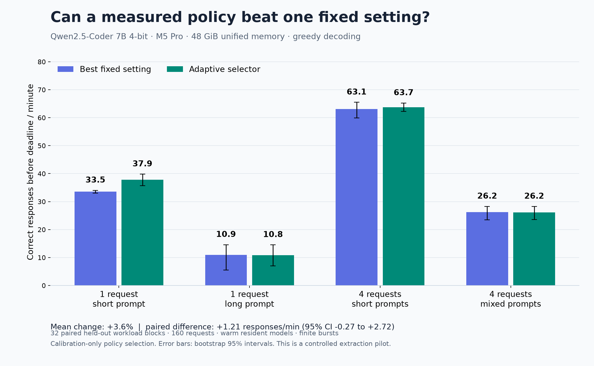

# A measured selector on an M5 Pro: working implementation, uncertain overall gain

Completed 19 November 2026. This is a controlled extraction pilot on one Apple M5 Pro with 48 GiB unified memory, using Qwen2.5-Coder 7B 4-bit weights and a 1.5B draft. Software and model hashes are in [the manifest](runs/pilot-002/environment.json).

The adaptive selector achieved **34.64 versus 33.43 correct, on-time responses per episode minute**, an observed **+3.6%**. The stratified paired bootstrap 95% interval for the difference is **−0.27 to +2.72 responses/minute**. It includes zero: **this pilot does not establish an overall improvement**.

Both policies answered **77/80 held-out tasks correctly**, with **76/80 correct before the deadline**. They ran separately on the same 80 prompts, giving 160 held-out executions across 32 paired workload blocks.



## What the controller learned

The calibration-selected fixed setting was `batch4_chunk256`. The adaptive policy selected `draft2` only for a single short request; it retained the fixed setting for the other three workload states. Selection used queue count and maximum prompt length, never expected answers or test results.

| Held-out workload | Fixed goodput/min | Adaptive goodput/min | Correct, each policy |
|---|---:|---:|---:|
| One short request | 33.53 | 37.86 | 8/8 |
| One long request | 10.89 | 10.84 | 7/8 |
| Four short requests | 63.10 | 63.70 | 32/32 |
| Four mixed requests | 26.19 | 26.15 | 30/32 |

For single short requests, mean completion time decreased from **1.780 to 1.596 seconds**, while mean time to first token increased from **0.383 to 0.434 seconds**. Faster completion did not mean an earlier first token. This subgroup observation is descriptive, with eight paired cases.

The other three states executed the same configuration under both policies. Differences there are repeat-run variation, not a different optimization. Two correct solo-long executions crossed the frozen 4.359-second deadline, one under each policy. That deadline sensitivity contributes to the uncertainty.

The primary aggregate is the **unweighted mean of episode goodputs over the balanced workload mix**. It is not the total number of requests divided by a production server's wall time. Peak active MLX memory across held-out executions was approximately **5.99 GiB**, including both resident models; this is not total system memory.

## The KV-precision failure was retained and reproduced

| Calibration configuration | Exact extraction correctness |
|---|---:|
| Ordinary serial KV | 28/30 |
| 8-bit KV, start threshold 0 | 28/30 |
| 4-bit KV, start threshold 0 | **0/30** |
| Greedy speculation, two draft tokens | 28/30 |
| Plain batch, 256-token prefill chunks | 28/30 |
| Plain batch, 1024-token prefill chunks | 28/30 |

Calibration excluded the 4-bit KV configuration on quality grounds. Its failed traces remain in the dataset.

A separate **post-pilot diagnostic**, using native `mlx_lm.stream_generate` without the lab Engine, padding mask or draft model, tested the four warmup prompts:

| Native control | Correct | Actual cache |
|---|---:|---|
| Ordinary KV | 4/4 | KVCache |
| 8-bit KV, threshold 0 | 4/4 | QuantizedKVCache |
| 4-bit KV, threshold 0 | **0/4** | QuantizedKVCache |
| 4-bit option, threshold 5000 | 4/4 | KVCache; quantization never activated |

The last row is a control for whether the optimization actually ran. These prompts plus outputs never reached 5,000 tokens. A successful run with a KV flag is not evidence that a quantized cache was used.

This reproduces a failure for **these weights, prompts, device and installed runtime**. It does not prove a universal problem with 4-bit KV caches or identify a library/kernel root cause. The diagnostic was not used to change the policy or the primary result. See [the diagnostic data](runs/pilot-002/NATIVE_KV_CONTROL.json) and [the reproduction script](native_kv_control.py).

## Verification and reproducibility

- All five [research-contract unit tests](verification/unit-tests.txt) passed from the publication checkout.
- The completed pilot contains 146 episodes, **374 model requests** and **35,452 generated tokens**, taking **783.6 seconds** (about 13.1 minutes). The four-hour argument was a ceiling, not the measured duration. Native controls and API tests ran afterward.
- Four real execution-path gates passed: quantized cache observation, actual batching, correct batch warmup outputs, and exact greedy speculative/serial token agreement.
- All **30 calibration speculative/serial output pairs** also had identical token sequences. This is finite greedy evidence; no stochastic distribution-equivalence claim is made.
- [The independent saved-data audit](runs/pilot-002/AUDIT.json) passed: 340 calibration/test executions rescored from independently reconstructed fixture answers; freeze hashes, code snapshots, deadlines, trace arithmetic, policy choices and paired coverage verified.
- [The API smoke test](runs/pilot-002/API_SMOKE_002.json) passed all nine checks, including four concurrent requests that produced an observed decode batch of four, a real single generation, invalid-body/token/budget/length handling, and service health afterward.
- The full implementation stayed byte-identical to the pilot's frozen `code_snapshot` while it ran.
- `runs/pilot-001` preserves an aborted pre-calibration run. Its initial deadline gate incorrectly required a flawless model; the revised gate rejects runtime errors and retains model mistakes as scored failures. No completed calibration or test was discarded.

The first API smoke result, [API_SMOKE.json](runs/pilot-002/API_SMOKE.json), is also preserved. Its standalone toy-output check expected raw JSON, while the model returned the correct array in a Markdown fence. The API returns unmodified model text and does not promise grammar-constrained output. The corrected smoke check accepts optional fences, consistent with the pilot's scoring convention; no serving or inference code changed for the second smoke run.

Reproduce the saved-data checks and graph:

```sh
python audit_run.py runs/pilot-002
python secondary_analysis.py runs/pilot-002
python plot_results.py runs/pilot-002
```

Run the native diagnostic after other GPU work has stopped:

```sh
.venv/bin/python native_kv_control.py \
  --model models/qwen-coder-7b --out runs/native-control-new.json
```

See [README.md](README.md) for installation, a new full pilot and the localhost API.

## Limits of the finding

Only one model family, one Mac, synthetic exact extraction, three calibration replicates per state and eight held-out paired replicates per workload were measured. Long prompts are approximately 2.8K tokens, short prompts approximately 320; this is not a long-context stress test. The generated records differ between calibration and testing, but the task schema remains the same.

Both models stay resident, KV caches are fresh, and the allocator cache is cleared outside the episode clock. Loading, tokenization and scoring are excluded. The actual serial and BatchGenerator API paths are compared; this is not isolated kernel attribution. No energy or thermal telemetry was collected, and background desktop activity was not experimentally eliminated.

The primary inference result is uncertain. A stronger next test would freeze this policy and evaluate a separately designed workload mix with more paired replicates, explicit arrival rates and latency deadlines. This run was not extended after seeing its confidence interval.
